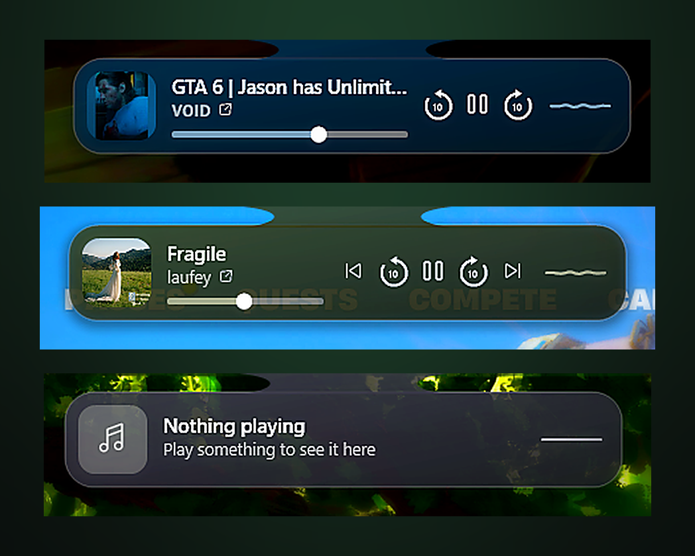
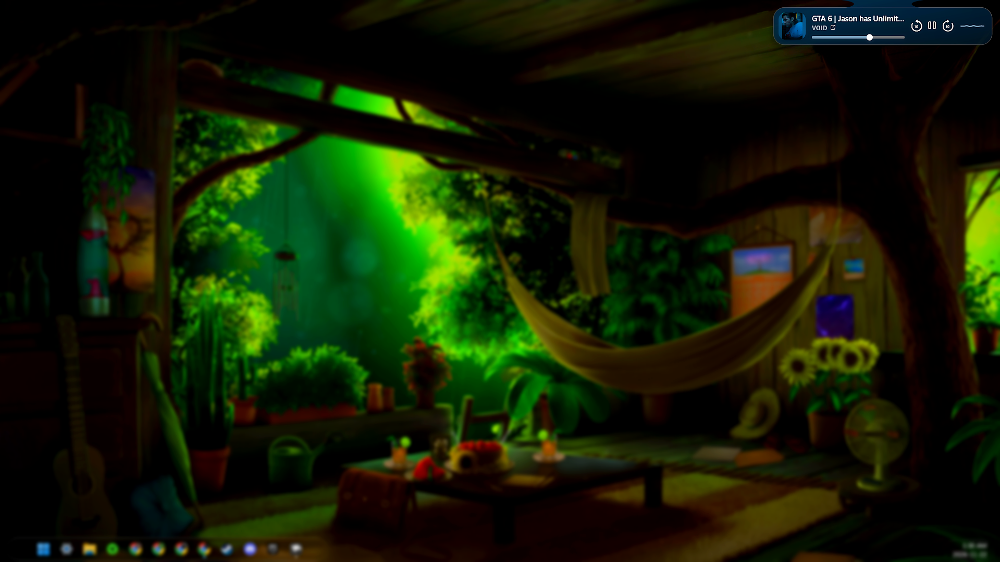
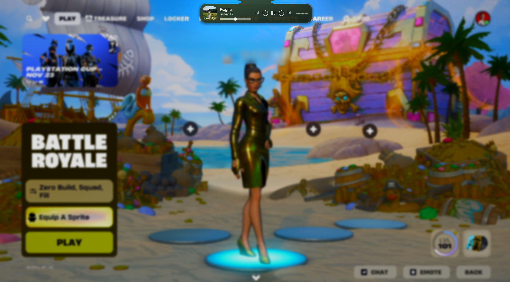
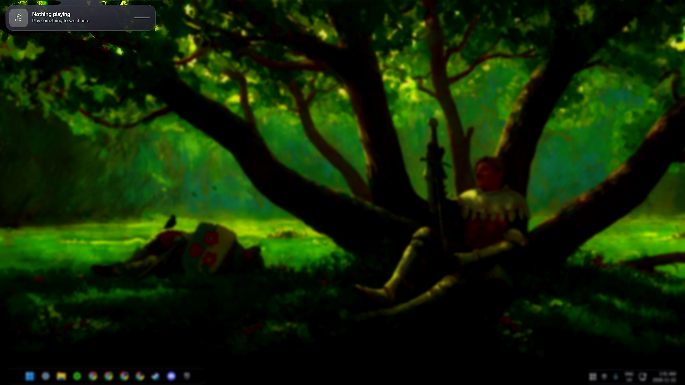

# Now Playing...

A sleek now-playing bar that drops down from the top edge of your screen when you hover there, then shows whatever music or audio you're listening to.

> **You need [Windhawk](https://windhawk.net) for this to work.** It's free. Now Playing... is a Windhawk mod, not a standalone app, so you install Windhawk first and then add the mod inside it (steps below).

It's a [Windhawk](https://windhawk.net) mod I made because I wanted something like the Dynamic Island, but my own thing. Instead of sitting there all the time, it hides at the top of your screen and drops down when you push your mouse up there, like the taskbar popping up but upside down.

## Screenshots

**On the desktop, playing a YouTube video**

**In Fortnite, pulled up with Persistent mode**

**Nothing playing**

## What it works with

Pretty much anything that shows up in Windows' media controls:

- Spotify, Apple Music, Amazon Music
- YouTube, SoundCloud, Twitch and other videos in Chrome, Edge, Opera GX, Firefox or Brave
- VLC, Media Player, Netflix and other video apps

Quick way to check an app: hit a volume key on your keyboard. If the song or video shows up in the little Windows popup, it'll show up here too.

## What's on it

- The album art or video thumbnail, with the app's icon in the corner
- Song title and artist. Names that use fancy fonts or emojis show up properly, no boxes
- A little ↗ button next to the artist that brings the app straight to the front
- Play/pause, plus 10 second skip back and forward
- Previous and next, but only when the app actually lets you skip (so you won't get a dead next button on a single YouTube video)
- A wave line that moves with the music (or bars if you like those better)
- A progress line you can click or drag to jump to any point in the song or video

## Stuff you can change

All of this is in the mod's Settings tab and it applies straight away.

- **Position:** top center, top left or top right
- **Monitors:** shows up on whichever monitor your mouse is on, or only your main one
- **Background:** auto (takes its colour from the album art), translucent, light, or a solid colour from the list (black, purple, navy, red, teal, gold and a bunch more)
- **The drip:** a little liquid neck that makes the bar look like it's hanging off the top of your screen. You can turn it off
- **Persistent mode:** press **Ctrl + Shift + ?** and the bar pops up instantly with no animation and stays up, even in games. Press it again to hide it. You can switch the hotkey to Shift + ?, Alt + N or Ctrl + Alt + M
- **Peek:** shows itself for a few seconds when a new song starts
- Size, width, corner roundness, animation speed, hover and hide delays

There's a lot more in the **Settings** tab to play around with, so tweak it however you like.

It stays hidden over full screen games and videos by default so it never gets in your way. If you want it in a game, use **Persistent mode**. It works in borderless or windowed fullscreen. Nothing can draw over true exclusive fullscreen.

## How to install

1. Install [Windhawk](https://windhawk.net)
2. Click **Create a New Mod**
3. Delete the sample code, paste in everything from [`now-playing-windhawk.wh.cpp`](now-playing-windhawk.wh.cpp)
4. Click **Compile Mod**, then **Exit Editing Mode**
5. Play something and push your mouse to the top of your screen

## Good to know

- On YouTube and other browser videos, the 10 second skip works by sending the player's own skip keys in the background (J and L on YouTube), since browsers don't let Windows move the video position directly.
- The mod runs inside Explorer, the same place taskbar mods run.

Made by [sultansaad-dev](https://github.com/sultansaad-dev).

## License

MIT
